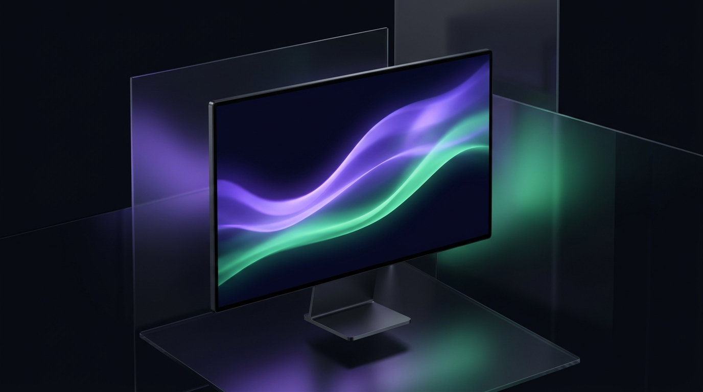
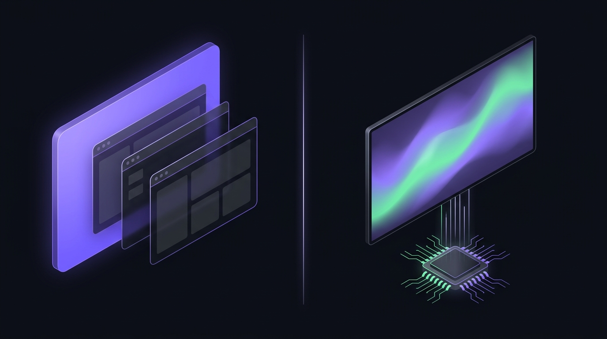
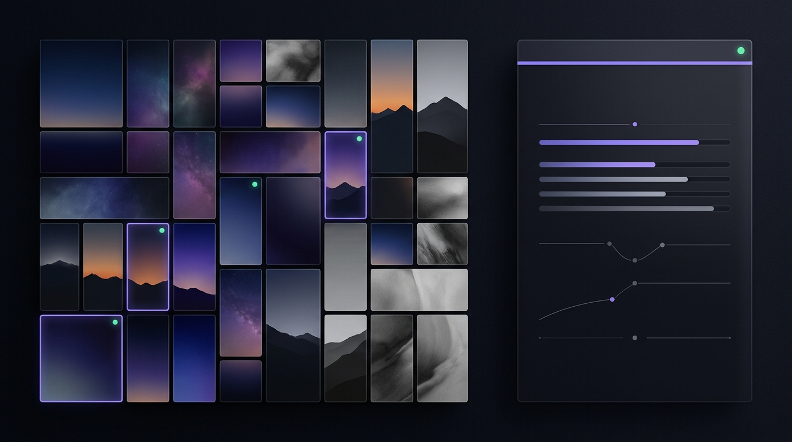

<div align="center">



# 流光 · Liuguang

**高性能 Linux 动态壁纸引擎 — Wayland 桌面壁纸层 & 无头 DRM/KMS 装饰屏**

[](LICENSE)
[](Cargo.toml)
[](docs/DEPLOYMENT.md)
[](docs/GUI.md)

[快速开始](#快速开始) · [双形态运行模式](#双形态桌面模式-vs-无桌面模式) · [界面与特性](#视觉与控制界面) · [文档导航](docs/README.md) · [参与贡献](CONTRIBUTING.md) · [开源协议](#开源协议)

</div>

---

**流光（Liuguang）** 是一款用 Rust 编写的轻量级 Linux 动态壁纸与展示屏引擎，支持在支持硬件上以 **VA-API 解码 → DMA-BUF 零拷贝** 直通输出视频与高清静态壁纸：4K60 仅需约 **12–19% 单核 CPU**，并在全屏应用、游戏进程、显存吃紧、电池供电或熄屏时自动暂停让路。

项目提供三件协同工具：
- `liuguang`：核心守护进程（Wayland `wlr-layer-shell` 桌面壁纸层 / 无头 DRM-KMS 输出）
- `liuguangctl`：命令行控制端与远程终端界面（`liuguangctl tui`，支持 SSH 控制）
- `liuguang-gui`：GTK4 + libadwaita「曜晶流光」桌面图形界面

---

## 双形态：桌面模式 vs 无桌面模式

<p align="center">
  
</p>

流光通过 `--persona` 与运行环境区分两种运行形态。**同一台桌面机器上请只启用其中一种**（桌面启用系统单元会争夺 DRM master 导致画面撕裂）：

| 维度 | 桌面模式（`user` · 日常推荐） | 无桌面模式（`system` · 展示屏 / Kiosk） |
|---|---|---|
| **典型场景** | 台式机 / 笔记本日常桌面壁纸 | 无桌面环境的广告屏、监控副屏、信息展板 |
| **渲染方式** | Wayland `zwlr_layer_shell_v1` Background 层 | 直接接管内核 DRM/KMS 输出（不启动合成器） |
| **systemd 单元** | `systemctl --user enable --now liuguang` | `sudo systemctl enable --now liuguang` |
| **配置文件** | `~/.config/liuguang/config.toml` | `/etc/liuguang/config.toml` |
| **控制 socket** | `$XDG_RUNTIME_DIR/liuguang/control.sock` | `/run/liuguang/control.sock` |
| **运行身份与权限** | 当前登录用户（只读访问媒体目录 + 缓存目录可写） | 系统用户 `liuguang`，属组 `liuguang-ctl`，补充组 `video render` |
| **输出名称查看** | `liuguangctl outputs` | `liuguangctl --persona system outputs` |

---

## 核心特性

| 能力 | 实现说明 |
|---|---|
| **零拷贝视频播放** | 基于 `liuguang-vaapi`（FFmpeg VA-API 解码 + `libva` 导出 DMA-BUF），支持合成器零转换直接扫描输出 |
| **合成器 NV12→RGB 修正** | 对只采样亮度平面（整屏发红）的合成器，自动在 GPU 端经 EGL/GLES2 转为 RGB，全链路仍保持 DMA-BUF |
| **高帧率与低内存** | 实测 4K60 稳定零丢帧、4K120 可达 ~118.6fps；长时间暂停自动卸载解码管线释放显存与内存 |
| **五重自动让路** | 全屏窗口、游戏进程（Steam/Proton/Wine/Lutris/模拟器）、显存阈值、电池供电、熄屏五信号独立仲裁、互不覆盖 |
| **智能兼容转码** | 硬解不支持的素材（8K H.264 / 10bit / 12bit）可自动用 `ffmpeg` 转为高兼容缓存，绝不静默卡死软解 |
| **无闪烁实时画质调优** | 画面亮度（10%–100%）、裁剪适配（`cover`/`contain`/`stretch`/`center`）、缩放、偏移、旋转均实时下发，不重启解码管线 |

---

## 视觉与控制界面

<p align="center">
  
</p>

- **GTK4 图形界面（`liuguang-gui`）**：采用「曜晶流光（Obsidian Crystal）」暗色设计语言，媒体库支持无间隙 4/6 列自动比例**画报墙排版**、悬停局部聚光灯与两帧动态预览、侧栏实时亮度/适配检查器、播放列表与自动转码进度。
- **终端控制台（`liuguangctl tui`）**：与 GUI 统一调色板与状态语义，支持 4 档终端自适应布局、顶栏实时遥测（FPS / CPU / 内存 / 暂停原因胶囊）、媒体兼容性与正在使用状态、亮度与适配按键实时调节（`b`/`B`、`0` 重置），通过 `ssh -t` 即可管理远程展示屏。

---

## 快速开始

### 1. 直接下载预编译安装包（推荐，无需编译）

前往 **[GitHub Releases](https://github.com/suluoMISS/liuguang/releases/latest)** 下载对应发行版包（Arch `.pkg.tar.zst`、Debian/Ubuntu `.deb`、Fedora/RHEL `.rpm` 或通用二进制包）：

- **Arch Linux**（内置 `vaapi` 零拷贝）：`sudo pacman -U liuguang-*.pkg.tar.zst liuguang-gui-*.pkg.tar.zst`
- **Debian / Ubuntu**：`sudo apt install ./liuguang_*.deb ./liuguangctl_*.deb ./liuguang-gui_*.deb`
- **Fedora / RHEL**：`sudo dnf install ./liuguang-*.rpm ./liuguangctl-*.rpm ./liuguang-gui-*.rpm`

安装后直接从应用菜单启动 **流光（`liuguang-gui`）**，首次打开如提示后台未运行，点界面里的 **「一键启动并启用服务」** 即可自动初始化配置与媒体库。

### 2. 环境体检与一键安装脚本

安装脚本自带只读体检与显式权限请求（需要提权时说明原因并调用 `sudo` / `pkexec`）：

```bash
./scripts/install.sh --check            # 仅体检环境、/dev/dri 权限与配置状态
./scripts/install.sh --mode user        # 桌面形态：创建 XDG 配置/缓存与用户单元
./scripts/install.sh --mode system      # 无头形态：创建 liuguang 系统用户/组与系统单元
```

> 首次在桌面安装若 `/dev/dri/renderD*` 缺少读取权限，脚本会提示并将当前用户加入 `video,render` 组；`liuguang-user.service` 已配置 `CacheDirectory=liuguang`，首次启动自动授权写入缩略图与转码缓存。

### 3. 从源码构建（及国内 crates.io 加速）

需要 Rust **1.85+**（edition 2024）、Wayland/DRM/GStreamer 开发包，以及可选的 `ffmpeg`/`libva`（零拷贝视频）和 `gtk4`/`libadwaita`（图形界面）：

> 国内网络若 `cargo` 拉取 crates.io 较慢，可先配置 `rsproxy.cn` 镜像（新建 `~/.cargo/config.toml` 写入 `crates-io` 替换源 `https://rsproxy.cn/crates.io-index`）。

```bash
git clone https://github.com/suluoMISS/liuguang.git
cd liuguang

# Arch Linux 本地打包（推荐，打包环境自动启用 vaapi）
(cd packaging/arch     && makepkg -f)
(cd packaging/arch/gui && makepkg -f)
sudo pacman -U dist/arch/liuguang-*.pkg.tar.zst dist/arch/liuguang-gui-*.pkg.tar.zst

# 或者直接编译守护进程 + 控制端 CLI/TUI（启用 VA-API 零拷贝）
cargo build --release -p liuguang -p liuguangctl --features liuguang/vaapi

# GTK4 图形界面（独立 workspace，避免无桌面的服务器安装 GTK 依赖）
./scripts/build-gui.sh --release --install

# 运行完整 CI 门禁（fmt / clippy / 默认与 feature 矩阵测试）
./scripts/ci.sh
```

---

## 常用控制命令

```bash
liuguangctl status                              # 查看状态、输出、解码路径与暂停原因
liuguangctl outputs                             # 列出可用显示输出名
liuguangctl set ~/Pictures/Wallpapers/clip.mp4 --pin
liuguangctl next | pause | resume | reload
liuguangctl transition slide --duration 800
liuguangctl tui                                 # 打开终端控制台
liuguang-gui                                    # 打开 GTK4 图形界面
```

---

## 实测基准参考

| 场景 | 单核 CPU 占用 | 实测帧率 |
|---|---|---|
| 1080p60 视频壁纸（VA-API 零拷贝） | ~4.5–6% | 60.0 fps |
| 1440p60 视频壁纸 | ~8–10% | 60.0 fps |
| 4K60 视频壁纸（`dropped_late=0`） | ~12–19% | 60.0 fps |
| 4K120 视频壁纸 | ~19–21% | 118.6 fps |
| 8K60 HEVC | ~30.6% | 60.1 fps |
| GPU NV12→RGB 修正路径（4K60） | ~13.7% | 58.5 fps |

---

## 文档导航

| 文档 | 内容 |
|---|---|
| [docs/DEPLOYMENT.md](docs/DEPLOYMENT.md) | **桌面模式 vs 无桌面模式**详尽部署、权限模型、安装/卸载与故障排查 |
| [docs/CONFIGURATION.md](docs/CONFIGURATION.md) | 全部 TOML 配置项、`LIUGUANG_*` 环境变量与默认路径 |
| [docs/USAGE.md](docs/USAGE.md) | `liuguang` / `liuguangctl` 命令手册、状态字段解析与常见任务 |
| [docs/GUI.md](docs/GUI.md) | 图形界面功能、曜晶画报墙排版、实时调节与自检 |
| [docs/TUI.md](docs/TUI.md) | 远程终端界面页面、快捷键与四档自适应布局 |
| [docs/ARCHITECTURE.md](docs/ARCHITECTURE.md) | Crate 分层架构、渲染与解码管线、五重暂停仲裁设计 |
| [docs/IPC_PROTOCOL.md](docs/IPC_PROTOCOL.md) | Unix Socket + NDJSON 协议规范与方法/事件清单 |
| [docs/DEVELOPMENT.md](docs/DEVELOPMENT.md) | 开发构建、Feature 矩阵、代码规范与扩展指南 |
| [docs/VERIFICATION.md](docs/VERIFICATION.md) | 验收口径、已验证结论与复现命令 |
| [docs/PROGRESS.md](docs/PROGRESS.md) | 当前版本交付清单与后续路线 |

---

## 开源协议

本项目基于 **MIT License (`MIT`)** 协议开源，详见 [LICENSE](LICENSE)。

仓库主页：<https://github.com/suluoMISS/liuguang>

---

## Nix / NixOS

```bash
nix run github:suluoMISS/liuguang#liuguang-gui      # 直接运行 GUI
nix profile add github:suluoMISS/liuguang#liuguang github:suluoMISS/liuguang#liuguang-gui
```

NixOS（flake）：

```nix
inputs.liuguang.url = "github:suluoMISS/liuguang";
# modules = [ inputs.liuguang.nixosModules.default ];
services.liuguang = {
  enable = true;
  persona = "user";   # 桌面 Wayland 壁纸层；无头 DRM/KMS 用 "system"
};
```

也可用 `overlays.default` 获得 `pkgs.liuguang` / `pkgs.liuguang-gui`；`nix develop` 进入开发环境。
