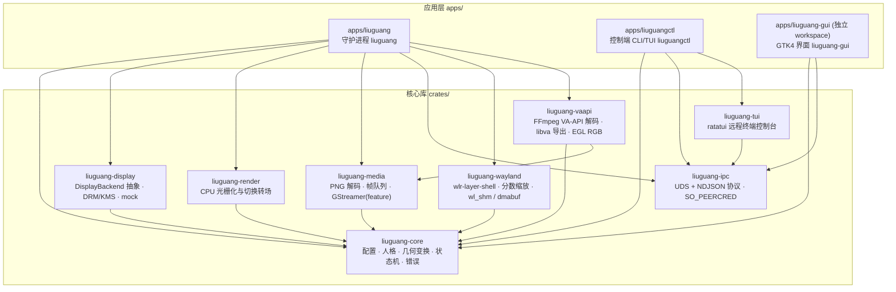

# 架构设计

流光（Liuguang）解决的核心问题是：**以尽量低的 CPU/GPU 开销将图片或高帧率视频稳定呈现为桌面壁纸或无桌面显示画面，并在需要 GPU/电量时自动让路。**

---

## 1. Crate 分层与依赖关系

### 为什么 `liuguang-gui` 独立在 workspace 之外？

无头展示屏或服务器编译部署 `liuguang` / `liuguangctl` 时不需要安装 GTK4 / libadwaita 开发包。将 `apps/liuguang-gui` 作为独立 Cargo workspace（[`apps/liuguang-gui/Cargo.toml`](../apps/liuguang-gui/Cargo.toml)）保证了服务端极简编译与桌面独立打包解耦。

---

## 2. 双形态显示路由

流光在“获取媒体 → 帧调度 → 暂停仲裁”阶段完全统一，只在最末端的显示提交（`DisplayBackend`）按运行形态分叉：

- **桌面模式（`Wayland` 后端）**：连接合成器并使用 `zwlr_layer_shell_v1` 将画面挂入 `Background` 层，输入区域置空不挡鼠标事件，支持 `wp_fractional_scale_v1` 与 `wp_viewport`，由合成器掌管屏幕模式与 DRM master；
- **无桌面模式（`DRM/KMS` 后端）**：直接打开 `/dev/dri/card*` 进行原子页翻转提交，带 `DRM_IOCTL_SET_MASTER` 显式接管与竞争自愈逻辑。

---

## 3. 解码与零拷贝渲染管线

1. **图片路径**：图片经解码后进入光栅化管线，按输出尺寸应用 `fit`/`zoom`/`offset`/`rotation`/`brightness`，写入 `wl_shm` 共享内存或 DRM dumb buffer 提交（长时间处于静态待机时零持续 CPU 占用，并在长时间暂停或空闲时自动释放闲置的 `wl_shm` 内存池）。
2. **GStreamer 回退路径（`feature = "gstreamer"`）**：解复用 + 解码后输出 RGBA/NV12 帧经 CPU 合成后提交，适用于不支持 VA-API 或 `contain` 留黑边等场景。
3. **VA-API 零拷贝直通（`feature = "vaapi"`）**：
   - `liuguang-vaapi::VaapiDecoder` 通过 FFmpeg VA-API 硬件解码并调用 `vaExportSurfaceHandle` 导出 DMA-BUF 文件描述符与修饰符；
   - 通过 `zwp_linux_dmabuf_v1` 直接交给合成器扫描输出（并借助 `create_immed` 同步导入降低帧间等待，4K60 稳定满帧）；
   - **GPU NV12→RGB 修正**：对仅把多平面 YUV 当作亮度单通道渲染导致整屏发红的合成器，`RgbConverter` 在 EGL/GLES2 内直接读取 Y/UV 平面并以 BT.601 着色器输出到 `XRGB8888` DMA-BUF（依然保持零拷贝），同时在着色器内实时完成 `fit`/`zoom`/`offset`/`rotation` 与 `brightness`（0.1–1.0）变换，**调参下一帧即时生效、无管线重启闪烁**。

> **长时间暂停资源回收**：当通道进入暂停超过 `PAUSE_UNLOAD_DELAY`（20 秒）后，守护进程会自动卸载重型视频解码管线与转换器，大幅回收常驻内存与显存；恢复播放时自动从记录的位置重建。

---

## 4. 六维叠加暂停仲裁

`apps/liuguang/src/daemon.rs` 为六种暂停原因各自维护独立集合（按优先级上报 `pause_reason`）：

1. `fullscreen`：Wayland `zwlr_foreign_toplevel_management` 全屏检测（支持 niri/sway 等）；
2. `screen_off`：读取 DRM/sysfs DPMS 状态；
3. `game_running`：低开销扫描进程特征（Windows `.exe`、Steam `AppId`、Proton、Lutris、`umu-run`、常见模拟器、自定义黑白名单）；
4. `gpu_memory`：NVIDIA（`nvidia-smi`）与 AMD sysfs 显存占用阈值迟滞开关（默认 >85% 暂停、<75% 恢复）；
5. `battery`：检测 `/sys/class/power_supply/*`，笔记本切换电池供电自动暂停、插电恢复；
6. `user`：CLI/GUI/TUI 手动暂停。

只有当所有集合均为空时才恢复播放，避免“游戏刚退出但全屏播放器仍在”时误恢复画面。

---

## 5. 媒体库、缩略图与智能转码

- **媒体索引**：`[library]` 限制允许根目录范围，扫描异步落入后台，支持按分辨率/帧率/编码/位深读取详细元数据；
- **缩略图服务**：进程内有界 LRU 缓存 + `$XDG_CACHE_HOME/liuguang/thumbs/` 两级磁盘缓存，配合低工人池并发与堆内存回吐（`malloc_trim`）避免打开图库后内存常驻膨胀；
- **兼容分类与自动转码**：`compat::classify` 识别硬件解码不兼容素材（如 8K H.264、10bit、不兼容容器），通过 `ffmpeg`（优先 `hevc_nvenc`，回落 `libx265`）原子转为高兼容缓存并通过 `MEDIA_PREPARED` 事件通知界面。
