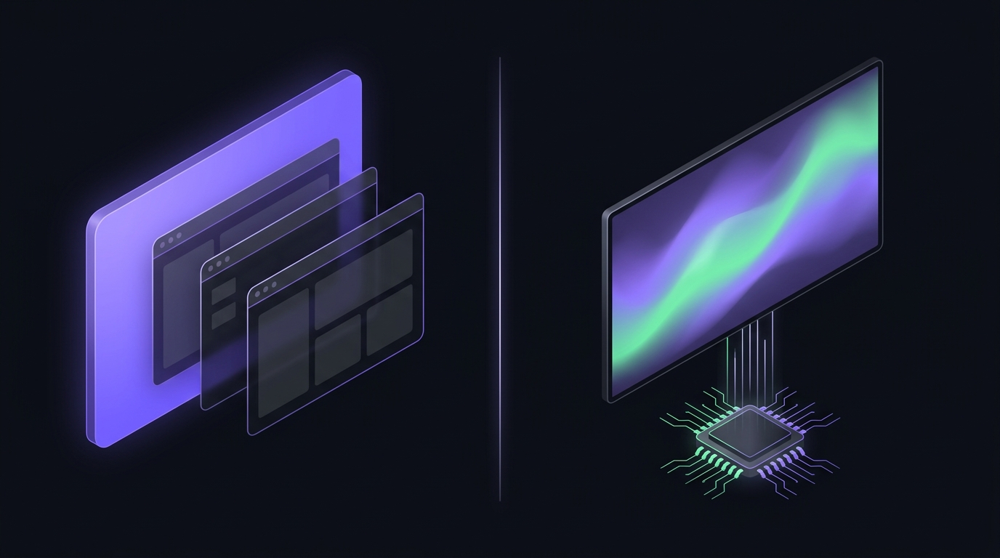
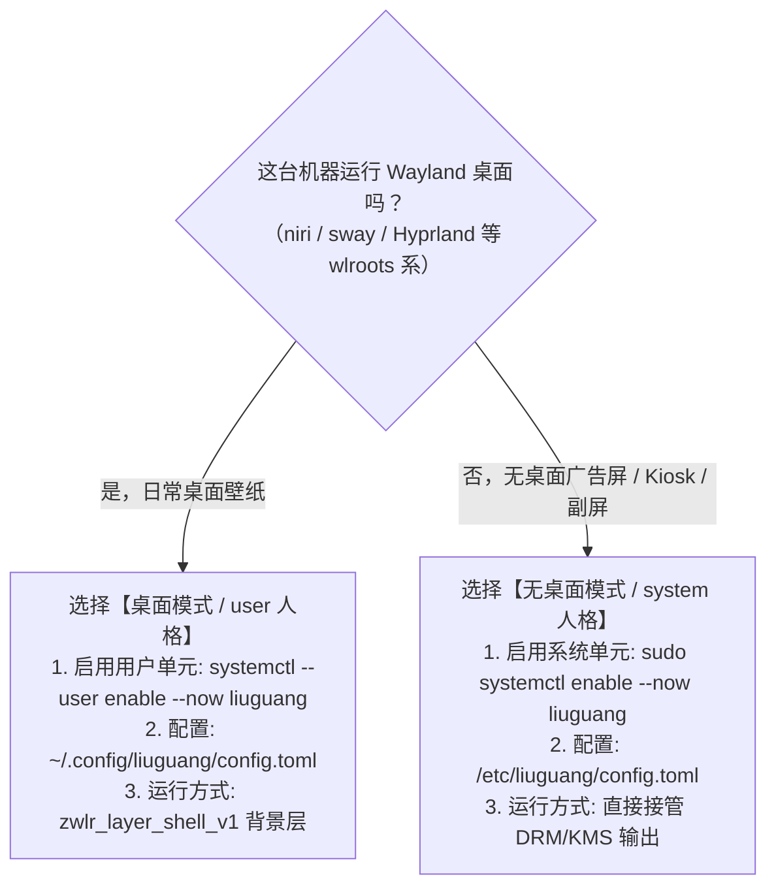

# 部署指南：桌面模式 vs 无桌面模式

<p align="center">
  
</p>

## 1. 先选形态（两者互斥）

流光支持两种完全不同的显示接入方式。**在有桌面环境的机器上，切勿同时启用系统服务**——系统单元会以独立权限争抢 DRM master，导致桌面合成器黑屏或撕裂。



| 对比项 | 桌面模式（`--persona user`） | 无桌面模式（`--persona system`） |
|---|---|---|
| **展示方式** | 通过 Wayland `wlr-layer-shell` 将壁纸置于所有窗口最底层 | 不依赖桌面/合成器，直接操作 `/dev/dri/card*` 进行 KMS 原子提交 |
| **支持环境** | niri、sway、Hyprland 等支持 `wlr-layer-shell` 的合成器（GNOME/KDE 原生不支持） | 任何具备 DRM/KMS 显卡节点的 Linux 系统 |
| **服务单元** | `packaging/liuguang-user.service`（`systemctl --user`） | `packaging/liuguang.service`（系统服务，开机默认 `disable`） |
| **运行身份** | 当前登录用户自己 | 系统用户 `liuguang`（主组 `liuguang-ctl`，补充组 `video render`） |
| **配置文件** | `$XDG_CONFIG_HOME/liuguang/config.toml` | `/etc/liuguang/config.toml` |
| **状态文件** | `$XDG_STATE_HOME/liuguang/state.json` | `/var/lib/liuguang/state.json` |
| **控制 Socket** | `$XDG_RUNTIME_DIR/liuguang/control.sock` | `/run/liuguang/control.sock` |
| **缓存目录** | `$XDG_CACHE_HOME/liuguang`（缩略图与转码缓存） | `/var/cache/liuguang` |
| **默认媒体目录** | `~/Pictures/Wallpapers` | `/srv/wallpapers/{images,videos}`（组 `liuguang-ctl` 2770 可写） |

---

## 2. 系统依赖

- **基础运行时**：Wayland 客户端库、`libdrm`、GStreamer（`base` / `good` / `libav`）
- **硬件硬解与零拷贝（推荐）**：`ffmpeg`、`libva`、`gst-plugin-va`（Intel 需 `intel-media-driver`，NVIDIA 需 `libva-nvidia-driver` 或闭源驱动自带 backends）
- **图形界面（可选）**：`gtk4 >= 4.12`、`libadwaita >= 1.5`、`gdk-pixbuf2`

| 发行版 | 安装命令 |
|---|---|
| **Arch Linux** | `sudo pacman -S wayland libdrm gstreamer gst-plugins-base gst-plugins-good gst-libav gst-plugin-va ffmpeg libva gtk4 libadwaita gdk-pixbuf2` |
| **Fedora** | `sudo dnf install wayland-libs libdrm gstreamer1{,-plugins-base,-plugins-good,-plugins-libav} gstreamer1-plugin-vaapi ffmpeg-free libva gtk4 libadwaita` |
| **Debian / Ubuntu** | `sudo apt install libwayland-client0 libdrm2 gstreamer1.0-{plugins-base,plugins-good,plugins-libav,libav} gstreamer1.0-vaapi ffmpeg libva2 libgtk-4-1 libadwaita-1-0` |

> **NVIDIA 提示**：请勿在全局环境变量中设置 `LIBVA_DRIVER_NAME=iHD`（仅适用于 Intel 核显），否则系统在 NVIDIA 渲染节点执行 `vaInitialize` 时会失败。

---

## 3. 安装方式

### 方式 A：一键安装脚本（推荐首次源码/手工安装）

仓库提供的 [`scripts/install.sh`](../scripts/install.sh) 具备幂等性检查与清晰的权限申请流程：

```bash
# 1. 只读体检（检测二进制、/dev/dri 权限、Wayland 会话、是否存在冲突单元）
./scripts/install.sh --check

# 2. 桌面模式（生成配置与用户单元，自动创建 ~/.cache/liuguang 与 ~/Pictures/Wallpapers）
./scripts/install.sh --mode user

# 3. 无桌面模式（说明原因并通过 sudo / pkexec 申请管理员权限建用户/目录/系统单元）
./scripts/install.sh --mode system
```

预览安装动作而不做任何修改可附加 `--dry-run`；如需卸载单元（保留配置与壁纸素材）执行 `./scripts/install.sh --mode user --uninstall` 或 `--mode system --uninstall`。

### 方式 B：Arch Linux 原生包（`makepkg`）

Arch 包会默认启用 `vaapi` 零拷贝特性，并把系统服务预设为 `disable`（防止桌面用户装完误抢 DRM）：

```bash
(cd packaging/arch     && makepkg -f)
(cd packaging/arch/gui && makepkg -f)
sudo pacman -U dist/arch/liuguang-*.pkg.tar.zst dist/arch/liuguang-gui-*.pkg.tar.zst

# 若选择桌面模式：
./scripts/install.sh --mode user

# 若选择无桌面展示屏模式：
sudo systemctl enable --now liuguang.service
sudo usermod -aG liuguang-ctl "$USER"   # 重新登录后可免 sudo 使用 liuguangctl
```

### 方式 C：Fedora RPM（`rpmbuild`）

详见 [`packaging/liuguang.spec`](../packaging/liuguang.spec) 与 [`packaging/RPM.md`](../packaging/RPM.md)。

---

## 4. 首次安装权限模型与 systemd 安全加固

流光遵循最小权限原则：

### 桌面用户单元（`packaging/liuguang-user.service`）

- 运行指令：`ExecStart=/usr/bin/liuguang --backend wayland`
- **目录放行与首启保证**：设置了 `ProtectHome=read-only` 以防止进程意外改写个人目录，同时使用：
  - `ConfigurationDirectory=liuguang`（`$XDG_CONFIG_HOME/liuguang` 可写）
  - `StateDirectory=liuguang`（`$XDG_STATE_HOME/liuguang` 可写，权限 `0700`）
  - `CacheDirectory=liuguang` + `CacheDirectoryMode=0700`（systemd 在首次启动前**自动创建并赋权** `$XDG_CACHE_HOME/liuguang`，彻底避免首次运行目录尚不存在时触发 `226/NAMESPACE` 启动失败）
- **GPU 与环境变量**：通过 `systemctl --user import-environment WAYLAND_DISPLAY XDG_CURRENT_DESKTOP XDG_RUNTIME_DIR` 确保用户服务第一时间拿到会话变量；用户需对 `/dev/dri/renderD*` 有读写权限（通常已在 `video`/`render` 组或由 `logind` ACL 授权）。

### 系统服务单元（`packaging/liuguang.service`）

- 以非特权系统账号 `User=liuguang`、控制组 `Group=liuguang-ctl` 运行；
- `SupplementaryGroups=video render`：通过 udev 组权限发现实际的 `/dev/dri/card*` 与 `/dev/dri/renderD*`，不在单元里写死 `card0`；
- `RuntimeDirectory=liuguang`（`0750`）保障控制 socket `/run/liuguang/control.sock` 保持 `0660` 权限，并通过 `SO_PEERCRED` + `/proc/<pid>/status` 仅放行 root、服务自身 UID 以及 `liuguang-ctl` 组成员；
- 媒体库 `/srv/wallpapers/{images,videos}` 由 `tmpfiles.d` 设为 `2770 liuguang:liuguang-ctl`（setgid），组成员无需 `sudo` 即可放入壁纸素材。

---

## 5. 常见问题排查

1. **`liuguangctl` 返回退出码 3（连不上 socket）**
   - 桌面模式请查 `systemctl --user status liuguang`；
   - 无桌面系统模式请确认已运行 `liuguangctl --persona system status`，且当前用户已加入 `liuguang-ctl` 并重新登录会话。
2. **媒体库显示「未配置媒体目录」（`NOT_CONFIGURED`）**
   - 检查配置里是否包含 `[library]` 段，以及 `root`、`image_dirs`/`video_dirs` 路径是否存在（`install.sh --mode user` 会自动生成并指向 `~/Pictures/Wallpapers`）。
3. **无桌面模式下屏幕停在黑屏但进程正常**
   - 用 `sudo scripts/drm-master-check.sh preflight` 检查是否已有其它进程占用了 DRM master；若同时开启了桌面会话，先关闭系统单元 `sudo systemctl disable --now liuguang`。
4. **桌面挂起唤醒后卡死（部分 NVIDIA 笔记本）**
   - 若合成器使用 S3 `deep` 睡眠导致异常唤醒，可在内核参数或合成器配置中将挂起模式切换为 `s2idle`。
