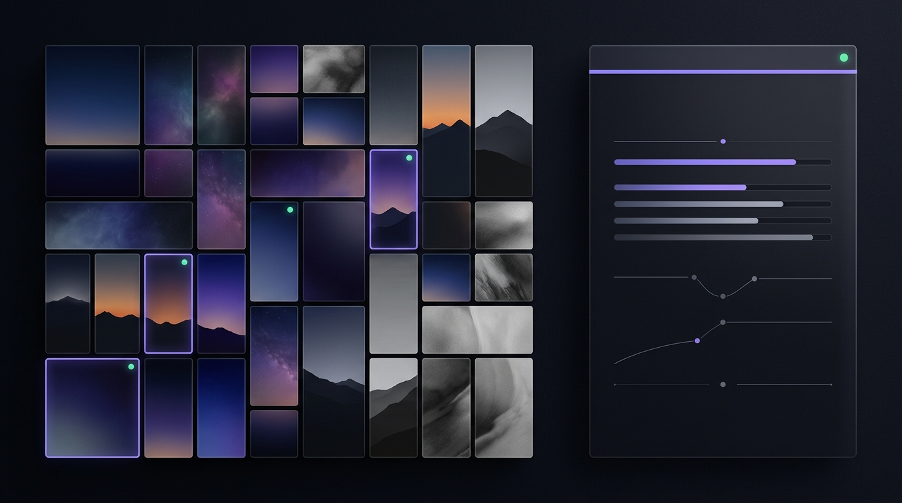

# 图形界面指南（`liuguang-gui`）

<p align="center">
  
</p>

`liuguang-gui` 基于 GTK4 与 libadwaita 构建，采用「曜晶流光（Obsidian Crystal）」深邃墨玉视觉风格，与守护进程通过独立的 Unix Socket IPC 通信（界面进程崩溃或关闭不会中断桌面壁纸播放）。

---

## 1. 页面布局

1. **媒体库（Library）**：
   - **曜晶画报墙排版**：根据容器宽度（4 列 / 6 列）与素材真实宽高比（横屏 / 竖屏 / 超宽）自动拼接严丝合缝的马赛克拼图，配以 3px 极细黑缝、静默暗场与悬停聚光灯高亮；
   - **快捷操作**：单击壁纸卡片即选中，在右侧属性栏按「应用」或直接双击/使用顶栏快捷控件切换；支持星标收藏（本地 `gui.json`）、搜索、排序、筛选（全部 / 图片 / 视频 / 收藏）及滑杆调节卡片高度。
   - **角标语义**：右上角展示干净整数帧率（如 `▶ 60`）；右下角两行标题分别显示文件名与分辨率/体积。
2. **属性与实时适配检查器（Inspector）**：
   - 状态胶囊清晰标识 `● 正在使用`（翡翠绿）与 `✓ 可直接播放 / ⚠ 需转码 / ✘ 不支持`；
   - **实时画质与适配**：提供输出选择、亮度滑杆与快捷预设（`50% / 75% / 100%`）、适配模式（裁切填充 / 完整显示 / 拉伸铺满 / 居中原始）、缩放、水平/垂直偏移、顺时针旋转（0°–270°），以及「重置适配」一键还原；所有调整经轻量去抖后通过 `set_output_transform` 实时无闪烁推送至 GPU 渲染层；
   - **转码准备**：对需要转码的素材显示进度条与「准备」操作。
3. **播放列表（Playlists）**：创建/编辑/删除播放列表，一键切换「单视频循环 / 顺序循环 / 随机播放」及轮换间隔，从媒体库一键加入当前播放列表。
4. **显示器（Outputs）**：查看已连接显示器的物理分辨率与刷新率、单独暂停/继续、切换下一张及检查实时解码路径与暂停原因。
5. **设置与关于（Settings）**：管理媒体库来源目录、全屏/熄屏/游戏/显存/电池供电自动暂停开关、VA-API 与 RGB 策略、桌面开机自启与项目关于弹窗（`MIT`，主页 <https://github.com/suluoMISS/liuguang>）。

---

## 2. 常用快捷键

- `Ctrl + F`：聚焦媒体库搜索框
- `Escape`：取消搜索或收起详情弹窗
- `Space`：暂停 / 恢复当前播放
- `?` / 菜单：打开内置快捷键速查窗口

---

## 3. 命令行参数与无人值守自检

```bash
liuguang-gui [--persona user|system] [--socket <路径>] [--config <路径>] [--self-test]
```

- `--self-test`：自动化验证 IPC 连通、媒体枚举、缩略图读取、输出查询与配置读写闭环（建议配合独立测试 socket 运行）。
